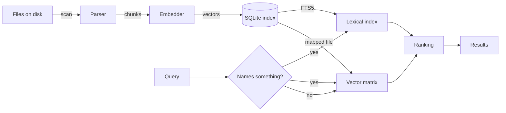

# How ish works

This page describes the machinery under `ish`: how a file becomes chunks, how
a chunk becomes a vector, and how a query becomes a ranked list. Each design
choice has a measurement behind it. The numbers on this page come from those
measurements.

## The pipeline



1. **Scan.** Walk the tree. Skip what git ignores and what the configuration
   excludes.
2. **Parse.** Divide each file into *chunks*: one function, one class, one
   Markdown section, one YAML test case.
3. **Embed.** Send each chunk to an embedding model. Store the vector.
4. **Search.** Embed the query. Score every stored vector. Optionally fuse a
   keyword ranking. Return the best matches.

## Chunks

A chunk is one named region of a file: a path, a line range, a kind, and a
symbol. The index stores where a chunk is, never what it says. A preview
reads the file again.

| Language | Parser | One chunk is |
|---|---|---|
| Python | `ast` | a function, a class, a method |
| C, C++ | tree-sitter | a function, a struct, a declaration |
| Markdown, AsciiDoc | heading scan | a section |
| YAML, JSON | document walk | one item of the first list in the document |

!!! note "Why the YAML split matters"
    One chunk per test case instead of one per file moved top-1 retrieval
    from 30 % to 90 % on 110 real specifications. One vector that stands for
    ten unrelated purposes matches none of them well.

Every chunk is capped at 8,000 characters. An embedding model reads a fixed
number of tokens and drops the rest without a signal. A larger chunk splits
into pieces.

## Embedding

The default backend is Ollama with `nomic-embed-text`. `ish` reaches it with
the standard library, because importing the client package cost 176 ms per
query.

**Task prefixes.** Some models expect a label that says whether a text is a
document or a query. `ish` adds `search_document:` to each chunk and
`search_query:` to each query. On this repository this moved top-1 accuracy
from 62 % to 75 %.

**Vectors are keyed by content.** A vector is stored under the hash of its
text and the model name, not under a path. A renamed file embeds nothing.
All worktrees of one repository share one vector store, so a new worktree
starts with every vector it needs.

**Searches go first.** Ollama serves one embedding request at a time. While
an index run embeds, a query leaves a marker, and the run waits between
requests. A keystroke beside a busy index run costs about 23 ms instead of
about 600 ms.

## Storage

Each tree has one SQLite file under `$XDG_DATA_HOME/ish/`, in WAL mode. A
reader never waits for a writer.

Beside each index, a `-matrix` file holds every vector as one float32 array.
A search maps that file into memory with numpy. The mapped file loads in
18 ms. Reading the same vectors out of SQLite cost 310 to 460 ms. The file is
a cache: SQLite stays the source of truth, and a `generation` counter tells
when the file is out of date.

The matrix file is not a lookup table. It holds only chunk ids and vectors,
so a search can score every chunk in one step. After the scoring, SQLite
gives the path, lines, and symbol of the best chunks only.

## Vector search

Every vector is normalized to unit length when it is stored. Cosine
similarity is then one dot product. `ish` scores the whole index as one
matrix multiplication:

```text
scores = matrix @ query_vector     # 1.3 ms for 7,834 chunks
```

It then reads only the winners out of SQLite.

## Lexical search

A vector is good at meaning and bad at exact names. A query such as
`parse_query` or `IshApp` names one thing. The closest vector can be a
different function that does something similar. The lexical half recovers the
exact match.

### What is indexed

An SQLite FTS5 table holds two columns per chunk. It does not hold the body.

| Column | Example |
|---|---|
| `symbol` | `PythonParser.parse` |
| `terms` | `Python Parser parse` plus the heading path |

`split_identifier()` builds `terms`. It cuts an identifier at case changes,
dots, and underscores, so a query word matches a part of a name. The
tokenizer is `porter unicode61`: it stems English words and splits on the
underscore.

A query becomes a safe FTS5 expression. Each word is quoted, and the words
are joined with `OR`:

```text
parse_query filters   →   "parse_query" OR "filters"
```

FTS5 orders the hits by BM25. A hit in `symbol` weighs twice as much as a
hit in `terms`.

### The gate

The lexical half runs only when the query names something.
`is_code_like()` says yes when a word has:

- an underscore: `parse_query`
- three or more capital letters: `HTTP`, `RRF_K`
- mixed case: `IshApp`, `HTTPServer`

`how is the config loaded` is prose and runs the vector half only.

!!! warning "The gate is not optional"
    Measured on 20 queries. Fusing the lexical order into every query cost
    10 points of top-1 on descriptive queries. With the gate, descriptive
    queries keep 90 % and identifier queries gain MRR .910 → .950.

### Fusion

When both halves run, each offers `max(4 × limit, 20)` candidates.
Reciprocal Rank Fusion merges the two lists:

```text
score(chunk) = Σ over each list:  weight / (60 + rank of chunk in that list)
```

| Constant | Value | Why |
|---|---|---|
| `RRF_K` | 60 | No list wins on its top hit alone |
| `SEMANTIC_WEIGHT` | 3.0 | The vector order is the stronger signal |
| `LEXICAL_WEIGHT` | 1.0 | Equal weights cost 10 points of top-1 |

A chunk that both halves rank well beats a chunk that only one half likes.
The score `ish` shows is always the cosine similarity, so the number means
the same thing whether or not fusion ran.

### Worked example

Query `parse_query`, limit 2:

| Chunk | Vector rank | Lexical rank | Fused score |
|---|---|---|---|
| `filters.parse_query` | 3 | 1 | 3/63 + 1/61 = **0.0640** |
| `filters.Filters` | 1 | — | 3/61 = 0.0492 |
| `completion.complete` | 2 | — | 3/62 = 0.0484 |

The exact match moves from third place to first.

## Filters

`lang:`, `type:`, and `under:` filter inside both halves, before the top
slice. A filter applied after the slice starved a narrow filter: `--type
code` once returned nothing at a limit of 20.

## Federation

A search of a directory reads every index below it as one. Each index keeps
its own matrix, and the scores merge. Index the parts of a large tree
separately and search from the root. See [Index](indexing.md).

## Latency budget

A CLI query against a 7,834-chunk index, three federated indexes:

| Step | Cost |
|---|---|
| Interpreter start | 60–80 ms |
| numpy import | 54 ms |
| Build embedder, open indexes | 33 ms |
| Embed the query | 54 ms |
| Score every vector | 48 ms |
| **Whole query** | **~380 ms** |

The MCP server and the TUI keep the process and the index open, so a query
there costs about 58 ms.
